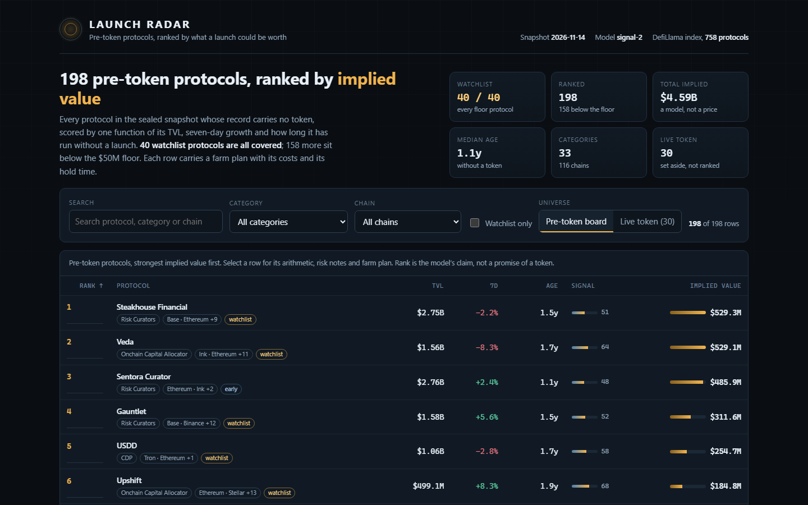
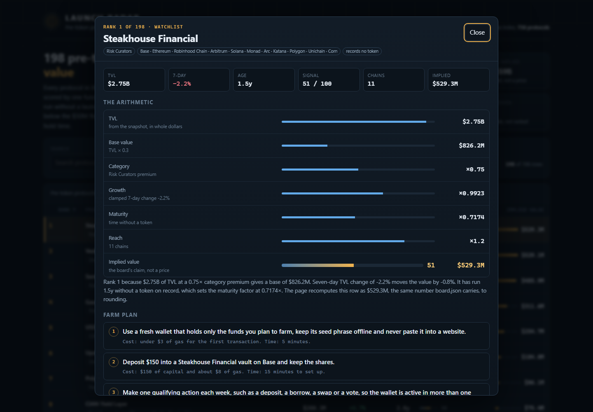
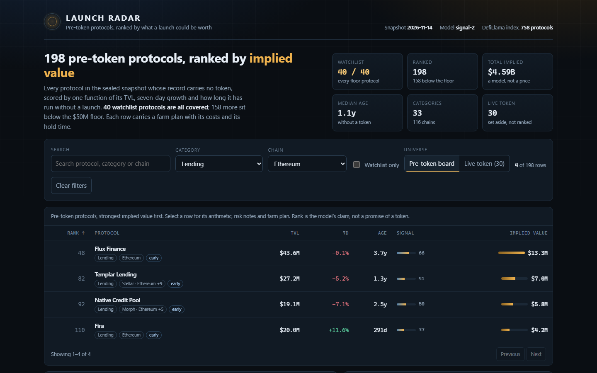

# Launch Radar

[](https://make.fun)
[](https://make.fun)
[](https://make.fun)

A static radar for **pre-token protocols**: every protocol in a sealed
DefiLlama snapshot that records no token, ranked by an *implied value* built
from its TVL, seven-day growth and time spent without a launch. Each row
carries the arithmetic and a farm plan with rough cost and time, so a rank is
never just a number.



## What it answers

- **Which pre-token protocols have the most TVL behind them?** 198 ranked
  rows, 40 of them the snapshot's own watchlist, the rest every other
  pre-token record above the $50M floor.
- **What could a launch be worth?** One formula, printed for every row:
  `implied = TVL × 0.30 × category premium × growth × maturity × reach`.
- **How would I farm it?** Three to twelve concrete steps per protocol, with
  an estimated cost and the wall-clock time, not a generic "use the protocol".



## The model

| Factor | What it does |
| --- | --- |
| Base | `TVL × 0.30` — a launch keeps a fraction of the capital already parked |
| Category | `0.5×` to `1.25×` by sector: risk curators and lending above CDPs and yield wrappers |
| Growth | `1 + clamp(7d change, −50%, +150%) × 0.35` — momentum counts, but capped |
| Maturity | `0.55 + min(age, 1460) / 1460 × 0.45` — four years without a token earns the full premium |
| Reach | `1 + 0.05 × (min(chains, 5) − 1)` — distribution across chains |
| Signal | 0–100 from the same inputs, shown separately so "large" and "likely" never blur |

The rank orders rows by implied value, strongest first; ties break on TVL then
slug, so two runs of the same snapshot produce byte-identical output. Live
tokens in the snapshot are listed separately and never ranked.



## Outputs

| File | What it is |
| --- | --- |
| `board.json` | 198 ranked rows plus the 30 live-token records set aside |
| `dashboard/` + `data.js` | The static board: search, category/chain filters, sorting, detail dialog, no network requests |
| `dossier.json` | Board, dashboard source and screenshots in one submission file |

## Run it

```bash
node main.ts --input /path/to/snapshot.json
```

`MAKEFUN_OUTPUT_DIR` chooses the output directory (default `./out`). The
dashboard is plain HTML, CSS and JavaScript; `python -m http.server` inside
`out/` is enough to open it, because the data is a script beside the page and
nothing is fetched at runtime.

The snapshot is sealed input for the bounty: the numbers are a point in time,
and the page says so. Nothing here is a price, a promise of a token, or
investment advice; the implied value is a model's claim.

## Licence

MIT, see [LICENSE](LICENSE).
